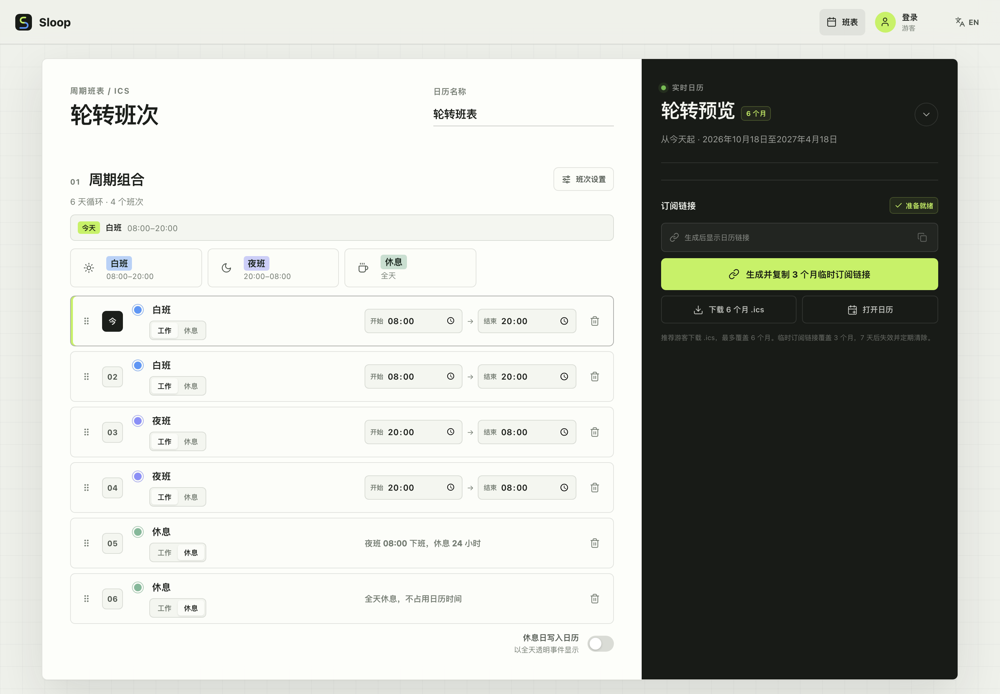
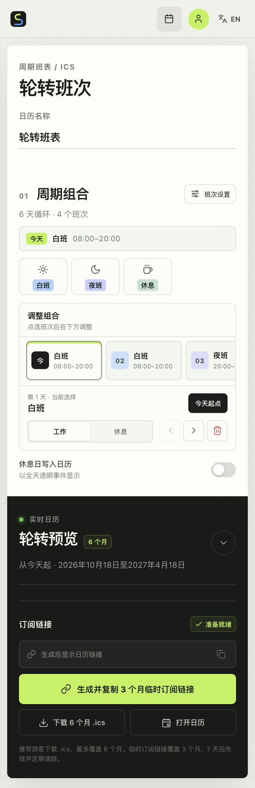

<p align="center">
  
</p>

<h1 align="center">Sloop</h1>

<p align="center">
  <strong>把循环班次变成一份可以长期订阅的日历。</strong><br>
  Turn repeating shifts into a calendar you can keep subscribed to.
</p>

<p align="center">
  <a href="#中文">中文</a> ·
  <a href="#english">English</a>
</p>

## 项目一览

Sloop 面向需要轮班的人：按自己的顺序排列白班、夜班、休息或自定义班次，指定周期从哪一天开始，然后导出 `.ics` 或生成订阅链接。它既能作为游客直接使用，也提供账户、成员审批、数据备份和自托管能力。

| | |
| --- | --- |
| 前端 | 原生 HTML、CSS、JavaScript，响应式布局，支持深色模式 |
| 服务端 | Cloudflare Worker，单文件 API 与 ICS 生成器 |
| 数据 | Cloudflare D1，SQL 迁移位于 `migrations/` |
| 部署 | Cloudflare Workers，或基于 Wrangler 本地运行时的 Docker 镜像 |
| 测试 | Node.js 内置测试运行器 |

### 界面预览

| 桌面端 | 移动端 |
| --- | --- |
| [](screenshots/sloop-pc-light.png) | [](screenshots/sloop-mobile-light.png) |

深色主题截图见 [`screenshots/sloop-pc-dark.png`](screenshots/sloop-pc-dark.png) 和 [`screenshots/sloop-mobile-dark.png`](screenshots/sloop-mobile-dark.png)。

---

## 中文

### 这是什么

很多日历工具擅长单次事件，却不擅长表达“工作两天、休息两天、再上四天夜班”这类不断重复的节奏。Sloop 把这个节奏建模为一个周期：周期内每天对应一个班次，今天则作为周期的锚点。生成日历后，未来每一行都从锚点继续推算。

生成的 `.ics` 可以下载到本地，也可以通过带签名的 URL 订阅。成员可在同一账户下保存多份周期，再将它们合并成一个日历。

### 能做什么

**编排轮班**

- 一个周期包含 1 到 35 天，班次可拖着排序，也可用键盘调整。
- 默认提供白班、夜班和休息，全部班次预设合计最多 12 个。
- 工作班次使用 24 小时制；结束时间不晚于开始时间时按跨夜处理。
- 每个班次可从 12 种颜色中选择，并同步显示在编辑区、预览和日历事件中。
- 点选任意一天即可把它设为“今天”，周期会从该位置开始循环。
- 休息日默认不写入日历；开启后以透明事件呈现。
- 编辑中的班表会保存在浏览器本地，刷新页面后仍可继续。

**导出与订阅**

- 游客无需注册即可下载最多 6 个月的 `.ics`。
- 游客也可创建 3 个月有效的临时订阅地址，地址在 7 天后失效。
- 成员最多保存 50 份周期，单份订阅默认覆盖 12 个月，可调整为 1 到 24 个月。
- 每份已保存周期都有稳定且带 HMAC 签名的订阅地址；编辑内容不会更换地址。
- 可将全部周期合并订阅，也可勾选部分周期生成单独签名、单独地址的合并日历。
- 页面提供复制链接、下载文件和打开 `webcal:` 三种入口。

**账户与管理**

- 登录名由字母、数字、下划线或连字符组成，不使用邮箱；昵称仅用于展示。
- 实例中的第一个注册账号自动成为管理员。
- 后续注册默认进入待审批状态；使用有效邀请码注册则立即通过。
- 管理员可审批、拒绝、停用或恢复账号，调整管理员/成员角色，并为其他用户重置密码。
- 邀请码可设置使用次数上限和过期时间，默认最多使用 1 次。
- 管理员可导出 JSON 备份，也可导入备份覆盖当前数据。
- 备份不包含临时游客订阅和登录会话；导入后会强制所有人重新登录。

**双语与时区**

- 界面支持简体中文和英文，会记住用户选择，并在首次访问时跟随浏览器语言。
- 周期保存 IANA 时区，默认 `Asia/Shanghai`。
- 日历事件会按每个事件所在日期的 UTC 偏移换算，能够正确处理夏令时切换。
- 英文界面在创建第一条订阅前会要求确认时区，减少跨地区使用时的误配。

### 快速开始

本地开发需要 Node.js 20+ 和 pnpm。

```bash
git clone https://github.com/XiGeMaX/sloop.git
cd sloop
corepack enable
pnpm install
cp .dev.vars.example .dev.vars
pnpm exec wrangler d1 migrations apply sloop-db --local
pnpm dev
```

打开 <http://localhost:2167>。第一个完成注册的账号会成为当前实例的管理员。

`pnpm dev` 启动前会调用 esbuild，把前端入口和 `i18next` 资源打包为 `public/app.bundle.js`。这个文件只用于本地运行和部署构建，已加入 `.gitignore`。

### 环境配置

`.dev.vars` 在本地由 Wrangler 读取。生产环境应使用稳定、随机的签名密钥：

```dotenv
LINK_SIGNING_SECRET=replace-with-a-long-random-secret
```

生成一个 256 位随机值：

```bash
node -e "console.log(require('node:crypto').randomBytes(32).toString('hex'))"
```

| 变量或绑定 | 用途 |
| --- | --- |
| `LINK_SIGNING_SECRET` | 为成员单周期订阅和合并订阅生成 HMAC 签名；生产环境必须设置 |
| `DEFAULT_TIMEZONE` | 新建周期的默认时区，默认 `Asia/Shanghai` |
| `APP_ENV` | 应用环境标识，Wrangler 和 Docker 默认均为 `production` |
| `PORT` | Docker 容器监听端口，默认 `2167` |
| `DB` | D1 数据库绑定，由 `wrangler.jsonc` 配置 |
| `ASSETS` | 静态资源绑定，指向 `public/` |

更换 `LINK_SIGNING_SECRET` 会让此前生成的全部成员订阅链接失效。`GET /api/health` 可用于检查 D1 连接，并确认签名密钥是否已经配置。

> [!IMPORTANT]
> `.dev.vars` 不应提交到版本库。生产环境请通过 Wrangler Secret、容器编排平台的 Secret 或其他密钥管理系统注入签名密钥。

### Docker 自托管

Docker 镜像通过 Wrangler 的本地 Workers 运行时启动应用，D1 数据存放在 `/data`。容器每次启动都会先应用数据库迁移，然后监听 `2167` 端口。

可以创建下面的 `compose.yaml` 从源码构建：

```yaml
services:
  sloop:
    build: .
    container_name: sloop
    ports:
      - "2167:2167"
    environment:
      APP_ENV: production
      DEFAULT_TIMEZONE: Asia/Shanghai
      TZ: Asia/Shanghai
      LINK_SIGNING_SECRET: "${LINK_SIGNING_SECRET}"
    volumes:
      - sloop-data:/data
      - /etc/localtime:/etc/localtime:ro
    restart: unless-stopped
    stop_grace_period: 30s

volumes:
  sloop-data:
```

在相同目录放置 `.env`：

```dotenv
LINK_SIGNING_SECRET=replace-with-a-long-random-secret
```

然后启动：

```bash
docker compose up -d --build
```

访问 <http://localhost:2167>。请将 `sloop-data` 卷纳入备份计划；删除卷会同时删除账户、周期和邀请码。

如果启动时没有提供 `LINK_SIGNING_SECRET`，入口脚本会生成仅当前容器有效的临时密钥。容器重启后，旧签名链接将无法继续使用，因此正式部署应始终显式配置该变量。

GitHub Actions 会构建 `linux/amd64` 与 `linux/arm64` 镜像，并尝试发布到 GitHub Container Registry 和 Docker Hub。Docker Hub 发布需要仓库配置 `DOCKERHUB_USERNAME` 与 `DOCKERHUB_TOKEN`。

### Cloudflare Workers

1. 创建 D1 数据库。

   ```bash
   pnpm exec wrangler d1 create sloop-db
   ```

2. 将返回的 `database_id` 写入 `wrangler.jsonc`。如果目标是新建数据库，请替换文件中现有的 ID。

3. 添加生产签名密钥。

   ```bash
   pnpm exec wrangler secret put LINK_SIGNING_SECRET
   ```

4. 应用远程迁移并部署。

   ```bash
   pnpm exec wrangler d1 migrations apply sloop-db --remote
   pnpm deploy
   ```

Worker 同时提供 API 和 `public/` 静态资源。`wrangler.jsonc` 中的 Cron Trigger 每天清理过期游客订阅；部署完成后可继续绑定自定义域名。

### 权限与安全设计

| 身份 | 可执行操作 |
| --- | --- |
| 游客 | 下载 6 个月日历，创建 7 天有效、覆盖 3 个月的临时订阅 |
| 待审批用户 | 等待管理员处理，尚不能使用周期功能 |
| 成员 | 保存最多 50 份周期，创建 1 到 24 个月的订阅与合并订阅 |
| 管理员 | 拥有成员能力，并管理用户、邀请码、密码重置与数据备份 |

- 密码使用随机盐和 PBKDF2-SHA256（210,000 次迭代）存储。
- 会话 Cookie 带 `HttpOnly` 和 `SameSite=Lax`；HTTPS 下自动添加 `Secure`。
- 数据库只保存会话令牌的 SHA-256 摘要，不保存原始令牌。
- 写操作要求同源请求，降低跨站请求伪造风险。
- 游客临时令牌只以哈希形式写入数据库。
- 成员订阅使用服务端 HMAC-SHA256 签名；无效签名、被停用账号或错误合并选择统一返回 404。
- 日历响应带有私有缓存、`no-referrer` 与禁止索引提示，降低签名 URL 泄露风险。

> [!WARNING]
> 管理员备份包含密码哈希、用户资料和全部周期数据，应按敏感文件保管。导入操作会覆盖现有用户、邀请码和周期，并撤销全部会话。

### ICS 生成规则

- 班次时间先按周期时区换算，再以 UTC 写入 `DTSTART`/`DTEND`。
- 工作班次的结束时间早于或等于开始时间时，表示跨到第二天；开始与结束完全相同会被拒绝。
- 开启“休息日写入日历”后，普通休息日生成全天透明事件；跨夜班之后的休息从下班时刻起连续 24 小时。
- 日历声明 1 小时刷新间隔，但最终刷新频率由日历客户端决定。
- 合并订阅为每份周期分配独立 UID 命名空间，避免相同班次名产生冲突。
- 长行按 iCalendar 的 UTF-8 字节数限制折行。

### 开发与验证

```bash
pnpm test
pnpm check
```

`pnpm test` 覆盖计划校验、周期锚点、跨夜与休息规则、时区/夏令时、游客订阅、签名订阅、合并选择、备份恢复、管理员恢复和 ICS 转义/折行。

`pnpm check` 会检查 Worker、前端与国际化脚本语法，并重新构建浏览器包。

### 管理员恢复

先列出管理员：

```bash
pnpm admin:reset -- --list-admins
```

为本地或 Cloudflare 上的管理员生成临时密码：

```bash
pnpm admin:reset -- --username admin
pnpm admin:reset -- --username admin --mode remote
```

Docker 中必须指向持久化目录：

```bash
docker exec -it sloop \
  pnpm admin:reset -- \
  --username admin \
  --persist-to /data
```

恢复命令会撤销目标管理员的全部会话。完整参数、自定义密码和故障排查见 [`docs/admin-password-reset.md`](docs/admin-password-reset.md)。

### 目录结构

```text
public/
  index.html              应用页面
  app.js                  编辑器、账户、管理界面与浏览器端行为
  i18n.js                 中英文资源与 i18next 初始化
  timezone.js             时区校验与常用时区列表
  styles.css              响应式样式、主题与动效
  assets/brand/           图标和应用资产
worker.js                 API、认证、订阅、备份与 ICS 生成
migrations/               D1 表结构和升级脚本
scripts/                  管理员密码恢复命令
test/                     Worker、ICS、时区、i18n 与管理命令测试
docs/                     运维说明
brand/                    品牌规范和展示素材
screenshots/              README 截图
Dockerfile                Docker 镜像定义
docker-entrypoint.sh      容器启动、迁移与运行时配置
wrangler.jsonc            Worker、D1、静态资源与 Cron 配置
```

---

## English

### What it is

Calendar apps handle individual events well, but they are awkward for repeating rhythms such as two days on, two days off, then four night shifts. Sloop treats the pattern as a cycle: each position in the cycle has a shift, and one chosen position is "today". Every future date is derived from that anchor.

The result can be downloaded as an `.ics` file or exposed as a subscription URL. Signed-in members can store several cycles and combine them into one calendar.

### What you can do

**Build a rotation**

- Create a cycle of 1 to 35 days and reorder entries by drag and drop or the keyboard.
- Start with day, night, and rest shifts, then keep up to 12 shift presets in total.
- Set working shifts with 24-hour times. An end time at or before the start time becomes an overnight shift.
- Pick from 12 colors that carry through the editor, preview, and generated events.
- Select any cycle position to make it today and the anchor for the rotation.
- Keep rest days out of the calendar by default, or include them as transparent events.
- Keep an unfinished draft in browser storage across page reloads.

**Share or subscribe**

- Guests can download an `.ics` covering up to 6 months without an account.
- Guests can also create a 3-month temporary subscription that expires after 7 days.
- Members can store up to 50 cycles, each with a 1 to 24 month subscription range and a 12 month default.
- Saved cycles receive stable, HMAC-signed subscription URLs. Editing the cycle does not change its URL.
- Subscriptions can include every saved cycle or only a checked subset. A selected merge gets its own signed URL.
- Links can be copied, downloaded, or opened through `webcal:`.

**Manage people**

- Accounts use a username and password rather than email; the nickname is display-only.
- The first account created on an installation becomes its administrator.
- Later registrations need approval unless they use a valid invite code.
- Administrators can approve, reject, disable, or restore users, switch roles, and reset another user's password.
- Invite codes support a usage limit and optional expiry, with a default limit of one use.
- Administrators can export a JSON backup or import one to replace the current data.
- Temporary guest subscriptions and login sessions are excluded from backups. An import revokes every session so users must sign in again.

**Language and time zones**

- The interface is available in Simplified Chinese and English, remembers the selected language, and initially follows the browser locale.
- Every cycle stores an IANA time zone, defaulting to `Asia/Shanghai`.
- Event times are converted using the UTC offset in effect on each event date, including daylight-saving transitions.
- Before creating the first link in the English interface, Sloop asks the user to confirm the time zone.

### Quick start

You need Node.js 20+ and pnpm.

```bash
git clone https://github.com/XiGeMaX/sloop.git
cd sloop
corepack enable
pnpm install
cp .dev.vars.example .dev.vars
pnpm exec wrangler d1 migrations apply sloop-db --local
pnpm dev
```

Open <http://localhost:2167>. The first account registered against this instance receives the administrator role.

Before starting the development server, `pnpm dev` uses esbuild to bundle the frontend entry point and `i18next` resources into `public/app.bundle.js`. The generated bundle is ignored by Git.

### Configuration

Wrangler reads local values from `.dev.vars`. Set a stable random signing secret for any deployment that will use member subscriptions:

```dotenv
LINK_SIGNING_SECRET=replace-with-a-long-random-secret
```

Generate a 256-bit value with:

```bash
node -e "console.log(require('node:crypto').randomBytes(32).toString('hex'))"
```

| Variable or binding | Purpose |
| --- | --- |
| `LINK_SIGNING_SECRET` | HMAC key for member and merged subscriptions; required in production |
| `DEFAULT_TIMEZONE` | Default IANA time zone for new cycles; defaults to `Asia/Shanghai` |
| `APP_ENV` | Deployment environment label; Wrangler and Docker both default to `production` |
| `PORT` | Docker listening port; defaults to `2167` |
| `DB` | D1 database binding configured in `wrangler.jsonc` |
| `ASSETS` | Static asset binding pointing at `public/` |

Changing `LINK_SIGNING_SECRET` immediately invalidates all previously issued member subscription URLs. `GET /api/health` checks the D1 connection and reports whether a signing secret is present.

> [!IMPORTANT]
> Do not commit `.dev.vars`. In production, inject the signing secret through Wrangler Secrets, your container orchestrator, or another secret manager.

### Run with Docker

The Docker image starts the application with Wrangler's local Workers runtime and stores D1 data under `/data`. On each container start, pending migrations are applied before the server listens on port `2167`.

The following `compose.yaml` builds directly from the checkout:

```yaml
services:
  sloop:
    build: .
    container_name: sloop
    ports:
      - "2167:2167"
    environment:
      APP_ENV: production
      DEFAULT_TIMEZONE: Asia/Shanghai
      TZ: Asia/Shanghai
      LINK_SIGNING_SECRET: "${LINK_SIGNING_SECRET}"
    volumes:
      - sloop-data:/data
      - /etc/localtime:/etc/localtime:ro
    restart: unless-stopped
    stop_grace_period: 30s

volumes:
  sloop-data:
```

Create `.env` next to it:

```dotenv
LINK_SIGNING_SECRET=replace-with-a-long-random-secret
```

Start the service:

```bash
docker compose up -d --build
```

Then visit <http://localhost:2167>. Back up the `sloop-data` volume; removing it also removes users, cycles, and invite codes.

If `LINK_SIGNING_SECRET` is omitted, the entrypoint generates a temporary secret for that container only. A restart will then break existing signed links, so production installations should always provide the variable.

GitHub Actions builds `linux/amd64` and `linux/arm64` images and attempts to publish them to GitHub Container Registry and Docker Hub. Docker Hub publishing requires `DOCKERHUB_USERNAME` and `DOCKERHUB_TOKEN` repository secrets.

### Deploy to Cloudflare Workers

1. Create the D1 database.

   ```bash
   pnpm exec wrangler d1 create sloop-db
   ```

2. Put the returned `database_id` into `wrangler.jsonc`. Replace the existing ID when deploying against your own database.

3. Store the production signing secret.

   ```bash
   pnpm exec wrangler secret put LINK_SIGNING_SECRET
   ```

4. Apply the migrations remotely and deploy.

   ```bash
   pnpm exec wrangler d1 migrations apply sloop-db --remote
   pnpm deploy
   ```

The Worker serves both the API and the `public/` assets. A daily Cron Trigger in `wrangler.jsonc` removes expired guest subscriptions. A custom domain can be attached after the first deployment.

### Access model and safeguards

| Identity | Allowed actions |
| --- | --- |
| Guest | Download a 6-month calendar and create a 7-day temporary subscription covering 3 months |
| Pending user | Wait for administrator approval; cycle features remain unavailable |
| Member | Store up to 50 cycles and create subscriptions or merged subscriptions covering 1 to 24 months |
| Administrator | Use member features and manage users, invite codes, password resets, and backups |

- Passwords are stored with PBKDF2-SHA256, a random salt, and 210,000 iterations.
- Session cookies use `HttpOnly` and `SameSite=Lax`; HTTPS deployments also receive `Secure`.
- Only SHA-256 digests of session tokens are stored in D1.
- Mutating requests require a same-origin request context.
- Temporary guest tokens are persisted only as hashes.
- Member subscriptions use server-side HMAC-SHA256 signatures. Invalid signatures, disabled owners, and invalid merge selections all return 404.
- Calendar responses use private caching, `no-referrer`, and indexing protections to limit exposure of signed URLs.

> [!WARNING]
> An administrator backup includes password hashes, profile data, and every cycle. Treat it as sensitive. Importing a backup replaces all users, invites, and cycles, then revokes every session.

### How ICS output behaves

- Shift times are converted from the cycle's time zone and written as UTC `DTSTART`/`DTEND` values.
- For working shifts, an end time at or before the start time crosses midnight. Identical start and end times are rejected.
- With rest days enabled, regular rest days become all-day transparent events. Rest following an overnight shift starts when that shift ends and lasts 24 hours.
- Generated calendars advertise a one-hour refresh interval, though each calendar client decides when to refresh.
- Merged calendars use a separate UID namespace per source cycle, preventing collisions between identically named shifts.
- Long lines are folded according to iCalendar's UTF-8 byte limit.

### Development and verification

```bash
pnpm test
pnpm check
```

`pnpm test` covers plan validation, today anchoring, overnight and rest behavior, time zones and daylight saving, guest subscriptions, signed subscriptions, merged selections, backup restore, administrator recovery, and ICS escaping/line folding.

`pnpm check` validates the Worker, frontend, and i18n scripts, then rebuilds the browser bundle.

### Recover an administrator

List administrator accounts:

```bash
pnpm admin:reset -- --list-admins
```

Generate a temporary password for a local or remote administrator:

```bash
pnpm admin:reset -- --username admin
pnpm admin:reset -- --username admin --mode remote
```

Inside Docker, point the command at the persistent data directory:

```bash
docker exec -it sloop \
  pnpm admin:reset -- \
  --username admin \
  --persist-to /data
```

Recovery revokes every session for the selected administrator. See [`docs/admin-password-reset.md`](docs/admin-password-reset.md) for custom passwords, all options, and troubleshooting.

### Repository layout

```text
public/
  index.html              Application markup
  app.js                  Editor, account, admin UI, and browser behavior
  i18n.js                 Chinese/English resources and i18next setup
  timezone.js             Time zone validation and common zone list
  styles.css              Responsive styles, themes, and motion
  assets/brand/           Icons and application assets
worker.js                 API, auth, subscriptions, backups, and ICS generation
migrations/               D1 schema and upgrade scripts
scripts/                  Administrator recovery command
test/                     Worker, ICS, time zone, i18n, and recovery tests
docs/                     Operational documentation
brand/                    Brand guidance and presentation assets
screenshots/              README screenshots
Dockerfile                Container image definition
docker-entrypoint.sh      Container startup, migrations, and runtime configuration
wrangler.jsonc            Worker, D1, static assets, and Cron settings
```
